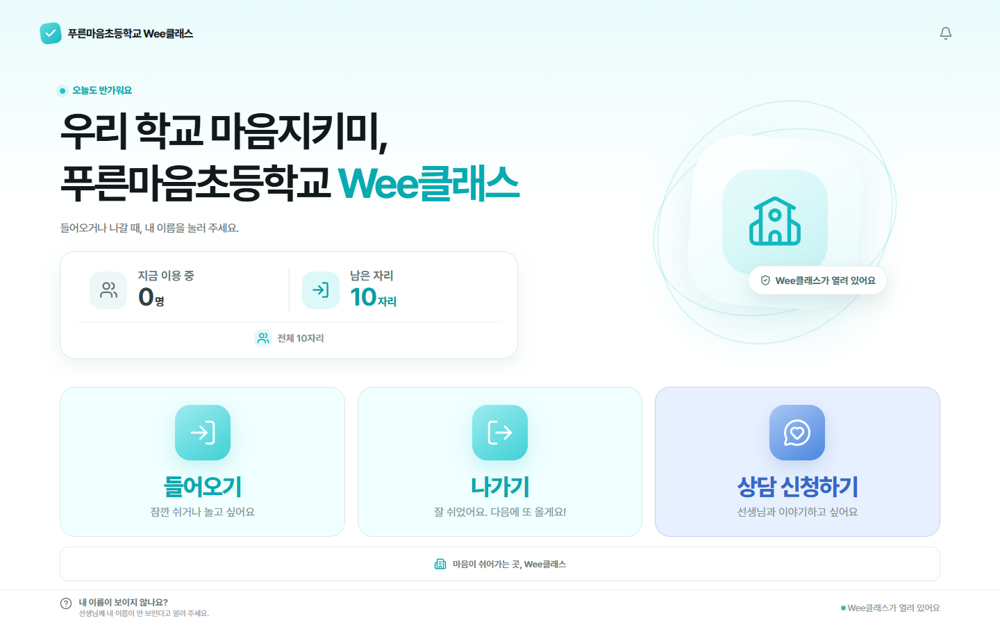
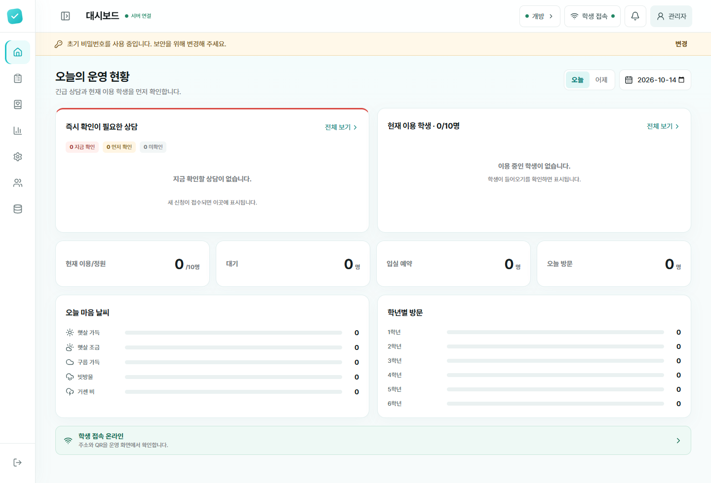
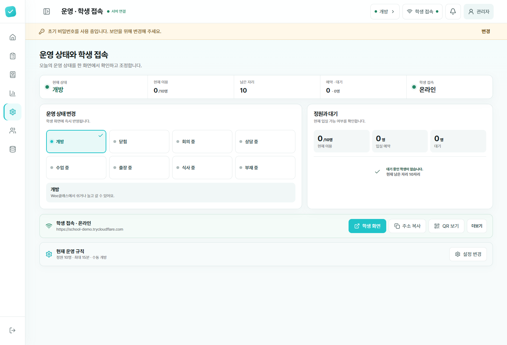

# Wee Check AP

> 학교 보안 Wi-Fi AP 안에서만 학생 기기와 통신하는 Wee Check 사설망 버전

Wee Check AP는 학생이 태블릿에서 자신의 이름을 눌러 들어오기·나가기를 기록하고, 교사는 관리자 PC에서 운영 상태와 상담 신청을 실시간으로 확인할 수 있도록 만든 도구입니다. 학생 정보는 외부 서버가 아니라 **관리자 Windows PC의 암호화된 로컬 데이터베이스**에 저장됩니다. Cloudflare Tunnel을 사용하지 않으며, 같은 보안 AP의 로컬 서브넷에서만 학생 화면에 접속합니다.



## 핵심 기능

| 영역 | 제공 기능 |
| --- | --- |
| 학생 출입 | 학년 → 학급 → 이름 선택, 들어오기·나가기, 현재 이용 인원과 남은 자리 표시 |
| 마음 날씨 | 입실 시 다섯 가지 마음 상태 선택, 관리자 통계와 학생별 기록 확인 |
| 상담 신청 | 고민 주제, 보호자 연락처, 안전 확인 답변 접수 및 긴급도 분류 |
| 정원·대기 | 전체 정원 제한, 자동 대기, 예상 순번, 5분 입실 예약, 관리자 취소·넘기기 |
| 놀이시간 | 수동 개방 및 시간표별 최대 이용시간 설정, 시간 초과 학생 표시 |
| 운영 상태 | 개방·닫힘·회의·상담·수업·출장·식사·부재 상태를 학생 화면에 즉시 반영 |
| 시간표 | 요일별 개방 시간, 대상 학년, 시간대별 최대 놀이시간 설정 |
| 학생 명렬표 | 학년·학급별 추가·수정·이동·제외, 학급별 일괄 등록, 전체 명렬표 교체 |
| 기록과 통계 | 날짜별 출입 기록, 현재 이용 학생, 마음 날씨 및 학년별 방문 통계 |
| 백업 | 수동·자동 암호화 백업, 복원, 학년도 마감 |
| 학생 접속 | 프로그램 실행과 동시에 사설망 학생 서버 시작, 로컬 IP 주소와 QR 제공 |

## 화면 미리보기

| 관리자 대시보드 | 운영 상태·학생 접속 |
| --- | --- |
|  |  |

관리자 화면은 데스크톱에서는 접이식 사이드바와 2열 카드 레이아웃을 사용하고, 작은 화면에서는 단일 열과 모바일 메뉴로 전환됩니다. 학생 화면은 교실 태블릿의 가로 화면을 우선해 큰 버튼과 넓은 터치 영역으로 구성했습니다.

## 교사용 빠른 시작

### 1. 설치 및 준비 사항

- 설치하는 PC: 64비트 Windows 10 또는 Windows 11, 학교 보안 AP 연결
- 설치 파일을 만드는 개발 PC: Node.js 20 이상, Inno Setup 7 64비트판

최종 설치 파일에는 Node.js 실행 환경이 포함됩니다. 설치 과정에서 번들된 Wee Check AP 전용 `runtime\node.exe`에 한해서만 학생 포트 `4174/TCP`를 Windows 방화벽의 모든 네트워크 프로필에서 `LocalSubnet` 범위로 허용합니다. 학교 그룹 정책으로 Wi-Fi가 `공용`으로 고정된 환경에서도 동작하며, 인터넷·다른 서브넷·다른 프로그램에서는 이 규칙을 사용할 수 없습니다. AP의 클라이언트 격리 기능은 꺼져 있어야 합니다.

학생 주소는 노트북의 사설 IPv4 주소로 자동 생성됩니다. 예: `http://192.168.0.15:4174/#/s/임의토큰`. AP가 IP를 바꾸면 관리자 화면에서 새 QR을 발급합니다.

### 2. Windows 설치 파일 만들기

개발 PC에서 Inno Setup을 준비한 뒤 설치 파일을 만듭니다.

```powershell
winget install --id JRSoftware.InnoSetup.7 -e -s winget -i
npm install
npm run installer:windows
```

완성된 `release\WeeCheck-AP-Setup-<버전>.exe`를 설치할 PC로 옮겨 실행합니다. 설치 프로그램은 먼저 일반 사용자 권한으로 안내와 설치 위치를 보여주고, 방화벽 설정 단계에서만 Windows 관리자 권한을 요청합니다. **바탕화면 바로가기와 시작 메뉴 바로가기**가 자동으로 생성되고 방화벽 규칙이 적용됩니다.

관리자 권한 요청을 취소하거나 학교 정책으로 방화벽 설정에 실패하면 파일 설치는 유지하되 프로그램을 자동 실행하지 않습니다. 사용자는 재시도 안내를 확인할 수 있으며, 이후 바탕화면 바로가기를 실행하면 같은 설명과 함께 방화벽 설정을 다시 시도합니다. 숨김 PowerShell에서 시작·종료 오류가 발생하면 별도의 오류 안내창을 표시합니다.

설치판은 현재 Windows 사용자 계정에 로그인할 때 자동으로 실행됩니다. 자동 실행은 Windows 설정의 앱 → 시작 프로그램에서 끌 수 있으며, 설치 제거 시 자동 실행 바로가기도 제거됩니다.

설치 없이 바로 실행하려면 다음 명령으로 `release\WeeCheck-AP-Portable-<버전>.exe`를 만듭니다.

```powershell
npm run portable:windows
```

포터블 EXE를 더블클릭하면 실행 파일을 `%LOCALAPPDATA%\WeeCheckAPPortableCache`에 자동 준비하고 관리자 화면을 엽니다. 별도 압축 해제와 설치 마법사는 없습니다. 종료할 때는 실행 창 또는 알림 영역 아이콘의 종료를 누릅니다. 설치된 앱·시작프로그램 등록은 하지 않으므로 PC를 다시 시작하면 매번 직접 실행합니다. 최초 실행 시 방화벽 권한 안내가 나타날 수 있습니다. 학생·상담 기록과 설정은 해당 PC의 `%LOCALAPPDATA%\WeeCheckAP`에 보관하며, EXE를 USB로 옮겨도 데이터는 이동하지 않습니다. 같은 PC에서는 설치판과 포터블판 중 하나만 실행하세요.

> [!NOTE]
> 현재 설치 파일은 코드 서명이 적용되지 않았으므로 Windows SmartScreen이 경고를 표시할 수 있습니다. 배포 전에 학교 또는 교육청의 소프트웨어 배포 정책을 확인하세요.

### 3. 프로그램 실행

바탕화면의 **Wee Check AP** 바로가기를 실행합니다. 이미 실행 중이라면 서버를 중복으로 시작하지 않고 기존 관리자 화면을 엽니다. 시작 메뉴의 **Wee Check AP 종료**로 백그라운드 서버를 종료할 수 있습니다.

한 번의 실행으로 다음 작업이 함께 진행됩니다.

1. 관리자 로컬 서버 시작
2. 학생용 로컬 서버 시작
3. Wi-Fi 어댑터의 사설 IPv4 주소 확인
4. 로컬 서브넷용 학생 접속 주소와 QR 생성
5. 관리자 페이지 열기

관리자 주소는 `http://127.0.0.1:4173/admin`입니다. 교사가 관리자 화면의 **운영 · 학생 접속**에 표시되는 QR 또는 주소로 태블릿 PC의 학생용 화면을 준비합니다. 학생은 준비된 태블릿을 사용하며 QR을 직접 읽지 않습니다.

> [!IMPORTANT]
> 최초 관리자 비밀번호는 `0000`입니다. 처음 로그인한 뒤 상단 경고 배너에서 반드시 8자 이상의 새 비밀번호로 변경하세요.

## 기본 운영 흐름

1. **학교 정보와 명렬표 등록**
   `학생 · 명렬표`에서 학교급과 학교 이름을 저장하고 학년·학급별 학생을 등록합니다.
2. **개방 방식 설정**
   `운영 · 학생 접속`에서 수동 개방 또는 요일별 시간표를 선택합니다.
3. **정원과 놀이시간 설정**
   정원은 1~99명, 최대 놀이시간은 5~180분 사이에서 설정할 수 있습니다.
4. **교사의 태블릿 접속 준비**
   같은 화면에서 사설망 주소나 QR을 확인해 교사가 태블릿 PC의 학생용 화면을 엽니다.
5. **대시보드 확인**
   긴급 상담, 현재 이용 학생, 대기·예약, 마음 날씨를 실시간으로 확인합니다.
6. **백업**
   중요한 명렬표 변경이나 학년도 마감 전에 `백업 · 학년도`에서 백업을 만듭니다.

## 관리자 메뉴

| 경로 | 용도 |
| --- | --- |
| `/admin/overview` | 긴급 상담, 현재 이용 학생, 정원·대기, 오늘의 핵심 지표 |
| `/admin/attendance` | 날짜별 입실·퇴실 시간, 마음 날씨, 학생별 타임라인 |
| `/admin/counseling` | 긴급도별 상담 목록, 연락처와 안전 확인 답변, 확인 완료 처리 |
| `/admin/statistics` | 마음 날씨 분포, 학년별 방문, 어려운 마음 응답 |
| `/admin/operations` | 운영 상태, 정원·대기, 개방 시간표, 학생 주소와 QR |
| `/admin/students` | 학교 정보, 학년·학급, 학생 명렬표, 일괄 등록·교체 |
| `/admin/system` | 암호화 백업, 복원, 학년도 마감 |

`/admin`으로 접속하면 `/admin/overview`로 이동합니다.

## 정원·대기·놀이시간

- 기본 정원은 **10명**, 기본 최대 놀이시간은 **30분**입니다.
- 정원이 차면 학생은 현재 인원, 예상 순번과 예상 입실 시각을 확인한 뒤 대기를 신청할 수 있습니다.
- 자리가 나면 첫 대기자에게 **5분 동안 유효한 입실 예약**이 자동 발급됩니다.
- 실제 이용 인원과 활성 예약의 합이 정원을 넘지 않도록 서버 트랜잭션에서 검사합니다.
- 최대 놀이시간이 지나도 학생을 자동 퇴실시키지 않으며, 관리자 화면에 **시간 초과**로 표시합니다.
- 운영 종료, 정원 기능 해제 또는 시간표 전환 시 남아 있는 대기와 예약을 정리합니다.
- 시간표마다 대상 학년과 최대 놀이시간을 별도로 설정할 수 있습니다.

## 학생 명렬표 관리

- 학교급에 맞는 학년과 학급을 직접 만들고 관리합니다.
- 학생 이름 수정, 다른 학년·학급으로 이동, 활성 명렬표에서 제외가 가능합니다.
- 학생을 이동하거나 이름을 바꿔도 기존 출입·상담 기록은 같은 학생 ID에 연결됩니다.
- 과거 기록에는 기록 당시의 학년과 학급이 유지됩니다.
- 학급별 이름 목록 추가·교체와 학교 전체 명렬표 교체를 지원합니다.
- 일괄 변경은 추가·유지·제외 인원을 먼저 미리 보여준 뒤 반영합니다.
- 같은 학년·학급의 동명이인은 이름 뒤에 번호 등 구분 가능한 표기를 사용해야 합니다.

## 상담 신청과 안전 안내

상담 신청은 출입 기록과 분리해 저장합니다. 학생은 고민 주제, 보호자 연락처와 세 가지 안전 확인 질문에 답하며, 관리자는 긴급·우선·일반 순서로 신청을 확인합니다.

초등학교 1·2학년은 연락처를 모를 때 **잘 모르겠어요**를 선택할 수 있으며, 이 경우 보호자 연락처 확인 필요 상태로 접수됩니다. 현재 도움이 필요하다는 응답은 긴급 확인으로, 자해 생각·안전 우려 또는 직접 이야기 요청은 우선 확인으로 표시됩니다.

> [!WARNING]
> 마음 날씨와 상담 질문은 표준화된 심리검사, 위기 선별 또는 진단 도구가 아닙니다. 화면의 우선순위만으로 안전을 판단하지 말고, 담당자가 학생을 직접 만나 학교의 위기 대응 절차에 따라 확인해야 합니다.

## 데이터 저장과 보안

- 데이터 위치: `%LOCALAPPDATA%\WeeCheckAP`
- 학생 이름, 보호자 연락처와 상담 답변: AES-256-GCM 암호화
- 암호화 마스터 키: Windows DPAPI로 보호
- 관리자 세션: HttpOnly·SameSite 쿠키, 8시간 후 만료
- 학생 접속: 임의 토큰이 포함된 당일 주소 사용, 서버에는 토큰 해시만 저장
- 관리자 API: `127.0.0.1:4173`에만 바인딩
- 학생 포트: `0.0.0.0:4174`에 바인딩하되 관리자 화면과 관리자 API는 제공하지 않음
- Windows 방화벽: Wee Check 전용 런타임의 TCP 4174만 허용, 모든 프로필, `LocalSubnet` 원격 주소로 제한
- 백업: 암호화된 `.wcbak` 파일, 최근 30개 유지
- 실시간 반영: SSE를 사용하며 연결이 끊기면 재연결

브라우저 `localStorage`가 아니라 로컬 서버의 SQLite 데이터베이스가 기준 데이터입니다. 프로그램을 종료해도 학교 정보, 명렬표, 출입·상담 기록과 운영 설정이 보존됩니다.

방화벽 규칙은 설치 시 한 번 준비되지만, 규칙 자체가 포트를 열지는 않습니다. Wee Check AP 서버가 실행 중일 때만 `4174` 리스너가 생기며, 종료 스크립트는 서버 프로세스를 끝낸 뒤 `4173`, `4174`, `5173` 리스너가 해제됐는지 확인합니다. 배포판 규칙은 번들된 실행 파일에만 묶여 있어 프로그램 종료 후 다른 프로세스가 이 허용 규칙을 재사용할 수 없습니다.

> [!IMPORTANT]
> 학생 접속은 AP 내부의 HTTP 통신입니다. 반드시 학교가 관리하는 암호화된 WPA2/WPA3 AP에서만 사용하고, 개방형·공용 Wi-Fi에서는 사용하지 마세요. 이 버전은 인터넷 터널이나 외부 클라우드 저장소로 학생 데이터를 전송하지 않습니다.

## 개발 환경에서 실행

```bash
npm install
```

현재처럼 원본 프로젝트 안의 `AP ver` 폴더에서 실행하고 상위 프로젝트에 이미 `node_modules`가 있다면 AP 폴더에서 `npm install`을 다시 실행할 필요가 없습니다. Node.js 24 환경에서 네이티브 모듈 설치가 인증서 오류로 중단되면 불완전한 `AP ver\node_modules`를 제거한 뒤 상위 의존성을 그대로 사용할 수 있습니다. 완전히 독립된 위치에서는 Node.js 20 또는 22 LTS와 조직의 정상 TLS 루트 인증서 설정을 사용해 `npm install`을 완료해야 합니다.

최초 1회 관리자 권한으로 방화벽 규칙을 만든 뒤 개발 서버를 시작합니다.

```powershell
npm run setup:ap
npm run dev
```

`npm run dev`는 학생 포트에서 제공할 프런트엔드를 먼저 빌드하고 로컬 관리자·학생 서버와 Vite 개발 서버를 시작합니다. 준비가 끝나면 학생용 사설망 주소가 같은 창에 표시되며, `Ctrl+C`를 누르면 관련 프로세스가 함께 종료됩니다.

개발 환경의 방화벽 규칙은 개발 PC에 설치된 `node.exe`에 연결됩니다. 배포 설치 프로그램은 이 개발 규칙을 그대로 사용하지 않고 설치 폴더의 전용 `runtime\node.exe`에 연결된 규칙으로 교체합니다. 따라서 개발 환경과 배포판의 실행 파일 범위가 분리됩니다.

- Vite 개발 화면: `http://127.0.0.1:5173`
- 관리자 서버: `http://127.0.0.1:4173/admin`
- 학생 서버: `http://<노트북 사설 IP>:4174` — 같은 AP와 유효한 학생 접속 토큰 필요

프로덕션 빌드와 검증 명령은 다음과 같습니다.

```bash
npm test
npm run build
npm start
```

## Windows 패키징 세부 사항

단일 설치 파일은 다음 명령으로 만듭니다.

```powershell
npm run installer:windows
```

빌드 과정은 먼저 `release\Wee-Check-Windows`에 실행 패키지를 구성하고, 이어서 `release\WeeCheck-AP-Setup-<버전>.exe`를 생성합니다. 설치 파일에는 다음 항목이 포함됩니다.

- 프론트엔드와 로컬 서버
- 검증된 Node.js 실행 파일과 런타임 의존성
- 번들된 Wee Check 런타임 전용, 모든 프로필/`LocalSubnet` 범위의 Windows 방화벽 설정 스크립트
- 실행·종료 스크립트와 Wee Check 아이콘
- 바탕화면·시작 메뉴 바로가기 설정

설치 제거 시 프로그램 파일과 바로가기는 삭제되지만 `%LOCALAPPDATA%\WeeCheckAP`의 데이터베이스와 백업은 보존됩니다.
설치 프로그램을 제거하면 Wee Check AP 전용 방화벽 규칙도 함께 제거됩니다. 개발 환경에서 규칙만 제거하려면 관리자 권한으로 `npm run teardown:ap`을 실행합니다.

압축을 풀어 사용하는 폴더형 배포본만 필요하면 다음 명령을 사용합니다.

```powershell
npm run package:windows
```

Windows 로그인 시 자동 시작이 필요하면 관리자 PowerShell에서 다음 스크립트를 실행합니다.

```powershell
.\scripts\install-windows-autostart.ps1
```

## 환경 변수

| 변수 | 설명 | 기본값 |
| --- | --- | --- |
| `WEE_CHECK_LAN_ADDRESS` | QR에 사용할 사설 IPv4 주소를 직접 지정 | Wi-Fi 주소 자동 선택 |
| `WEE_CHECK_STUDENT_BIND` | 학생 서버 바인딩 주소 | `0.0.0.0` |
| `WEE_CHECK_NODE_SOURCE` | Windows 패키징에 포함할 `node.exe` 지정 | 시스템 Node.js |
| `WEE_CHECK_ISCC_PATH` | Inno Setup 컴파일러 `ISCC.exe` 경로 지정 | 자동 탐색 |
| `WEE_CHECK_ADMIN_PORT` | 관리자 서버 포트 | `4173` |
| `WEE_CHECK_STUDENT_PORT` | 학생 서버 포트 | `4174` |

## 문제 해결

### 관리자 화면이 비어 있거나 열리지 않음

```bash
npm run build
npm start
```

관리자 주소가 `http://127.0.0.1:4173/admin`인지 확인합니다. 개발 중이라면 `npm run dev`가 프론트엔드와 서버를 모두 실행합니다.

### 학생 접속이 오프라인으로 표시됨

- 노트북과 학생 기기가 같은 보안 AP에 연결되어 있는지 확인합니다.
- 학교 그룹 정책으로 Wi-Fi 프로필이 `공용`으로 고정되어 있어도 괜찮습니다. `npm run setup:ap`으로 Wee Check 전용 규칙을 다시 적용합니다.
- AP의 `클라이언트 격리`, `AP isolation`, `무선 단말 간 통신 차단` 기능이 꺼져 있는지 확인합니다.
- 관리자 PowerShell에서 `npm run setup:ap`을 다시 실행해 TCP 4174 방화벽 규칙을 갱신합니다.
- VPN이나 가상 네트워크가 잘못 선택되면 `WEE_CHECK_LAN_ADDRESS`에 Wi-Fi IPv4 주소를 지정합니다.

### 관리자에서 바꾼 상태가 학생 화면에 반영되지 않음

- 교사가 태블릿 PC를 현재 QR 또는 주소로 접속했는지 확인합니다.
- 관리자와 학생 화면이 같은 PC에서 실행 중인 동일 서버를 바라보는지 확인합니다.
- 잠시 후 자동 재연결되지 않으면 학생 화면을 새로고침합니다.

### 데이터 백업 위치를 찾을 수 없음

관리자 화면의 `백업 · 학년도`에서 백업 목록을 확인합니다. 실제 파일은 `%LOCALAPPDATA%\WeeCheckAP\backups`에 저장됩니다.

## 개발자

Wee Check는 **서울특별시교육청 전문상담교사이자 학교심리학자인 김한석**이 제작했습니다.

- 제작자: 김한석
- 문의: [tedkim.psy@gmail.com](mailto:tedkim.psy@gmail.com)

## 저작권 및 이용 안내

Copyright © 2026 김한석. All rights reserved.

**본 프로젝트의 소스 코드, 문서, 이미지 및 배포 파일은 무단 재배포할 수 없습니다.** 사용 또는 배포 허가가 필요한 경우 [tedkim.psy@gmail.com](mailto:tedkim.psy@gmail.com)으로 문의해 주세요.

## 기술 구성

- React + TypeScript + Vite
- Fastify
- SQLite (`better-sqlite3`)
- Argon2 관리자 비밀번호 해시
- AES-256-GCM + Windows DPAPI
- Server-Sent Events
- Windows 사설망 AP 접속
- Vitest

---

Wee Check는 학생이 도움을 요청하기 쉬운 화면과 교사가 즉시 대응할 수 있는 운영 화면을 함께 제공하는 것을 목표로 합니다.
