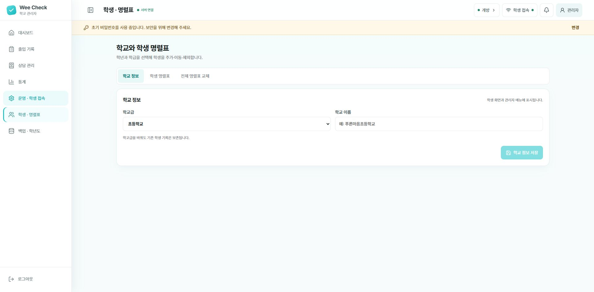
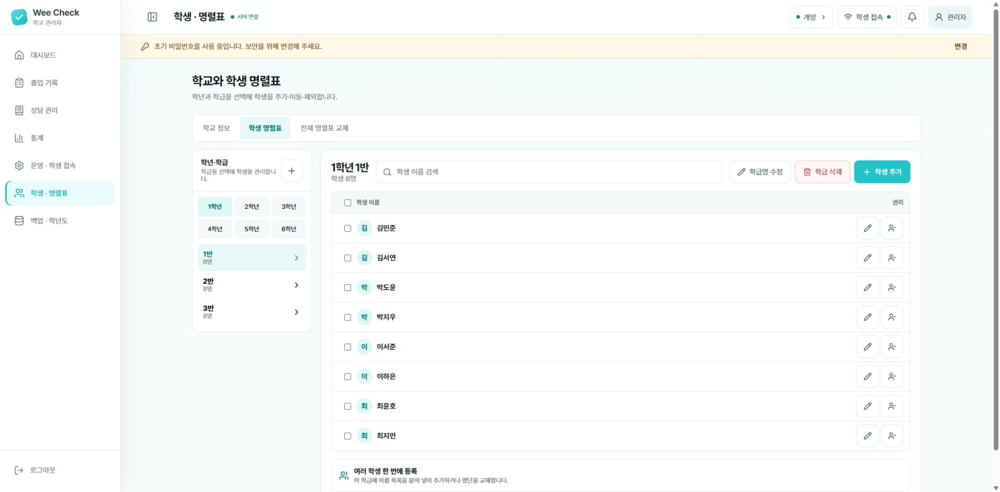

# Wee Check AP

> 학교가 관리하는 Wi-Fi 안에서 학생 출입, 마음 날씨, 상담 신청을 안전하게 운영하는 Wee클래스용 프로그램

Wee Check AP는 학교 전문상담교사가 별도의 개발 지식 없이 사용할 수 있도록 만든 Windows 프로그램입니다. 교사용 노트북에 프로그램을 설치한 뒤 학생들이 같은 학교 Wi-Fi에 연결하면, 관리자 화면의 QR 코드로 학생용 화면에 접속할 수 있습니다.

학생 이름, 출입 기록, 마음 날씨와 상담 신청 내용은 교사용 노트북에 암호화하여 저장합니다. 인터넷상의 별도 저장소에 학생 정보를 올리지 않습니다.

## 먼저 확인해 주세요

사용 전에 다음 조건을 확인합니다.

- 교사용 노트북은 64비트 Windows 10 또는 Windows 11을 사용해야 합니다.
- 교사용 노트북과 학생용 태블릿·휴대전화가 **같은 학교 Wi-Fi**에 연결되어야 합니다.
- 학교가 관리하는 암호화된 Wi-Fi에서만 사용합니다. 카페·도서관 등의 공용 Wi-Fi에서는 사용하지 마세요.
- 학교 Wi-Fi가 기기끼리의 통신을 차단하도록 설정되어 있으면 학생 기기에서 접속할 수 없습니다. 이 경우 학교 전산 담당자에게 “같은 Wi-Fi에 연결된 기기 사이의 통신이 허용되어 있는지” 문의하세요.
- 처음 설치할 때 Windows 관리자 권한이 필요할 수 있습니다.

## 1. 설치 파일 내려받기

아래 파일을 누른 뒤 GitHub 화면의 **Download raw file** 버튼을 눌러 내려받습니다.

### [WeeCheck-AP-Setup-0.1.2.exe 내려받기](AP%20ver/release/WeeCheck-AP-Setup-0.1.2.exe)

- 파일 크기: 약 33.05MB
- SHA-256: `5E757393DE24F0BB28620E85D3E0F4DEE4C29DB9773819784FF05590B9317ACD`

> [!IMPORTANT]
> 현재 설치 파일에는 유료 코드 서명이 적용되어 있지 않습니다. 따라서 Windows가 “PC 보호” 화면을 표시할 수 있습니다. 반드시 이 저장소에서 직접 내려받은 파일인지 확인하고, 학교 또는 교육청의 프로그램 설치 정책을 먼저 따르세요.

## 2. 프로그램 설치하기

1. 내려받은 `WeeCheck-AP-Setup-0.1.2.exe`를 더블클릭합니다.
2. Windows가 확인 창을 표시하면 파일 이름과 내려받은 위치가 맞는지 확인합니다.
3. 설치 안내를 읽고 설치 위치를 확인합니다.
4. 학생 기기의 접속을 허용하기 위한 Windows 방화벽 안내가 나타납니다. 내용을 읽은 뒤 계속합니다.
5. Windows 관리자 권한 요청 창이 나타나면 게시자와 실행 내용을 확인한 뒤 **예**를 누릅니다.
6. 설치가 끝나면 바탕화면과 시작 메뉴에 **Wee Check AP** 바로가기가 만들어집니다.

관리자 권한 요청을 취소하거나 학교 정책 때문에 설정이 완료되지 않으면 프로그램이 자동으로 시작되지 않습니다. 바탕화면의 **Wee Check AP**를 다시 실행하면 안내와 함께 설정을 다시 시도할 수 있습니다. 계속 실패하면 학교 전산 담당자에게 설치를 요청하세요.

## 3. 처음 실행하기

왼쪽에 메뉴 이름이 보이지 않으면 화면 왼쪽 위의 **사이드바 펼치기** 버튼을 누르세요. 아래 화면들은 처음 사용하는 상태를 기준으로 촬영했습니다. 명렬표의 이름은 프로그램에 포함된 예시입니다.

1. 바탕화면의 **Wee Check AP**를 더블클릭합니다.
2. 잠시 기다리면 웹브라우저에 관리자 화면이 열립니다.
3. 초기 비밀번호 `0000`을 입력합니다.
4. 로그인 직후 화면 위쪽의 비밀번호 변경 안내를 누릅니다.
5. 다른 사람이 추측하기 어려운 8자 이상의 새 비밀번호로 변경합니다.

관리자 화면은 프로그램을 실행한 교사용 노트북에서만 열립니다. 이미 실행 중일 때 바로가기를 다시 누르면 프로그램을 중복 실행하지 않고 기존 관리자 화면을 엽니다.

## 4. 학교 정보와 학생 명렬표 등록하기

**학교 정보** 탭에서 학교급과 학교 이름을 입력한 뒤 **학교 정보 저장**을 누릅니다.

**학생 명렬표** 탭에서는 왼쪽에서 학년과 반을 선택합니다. 오른쪽 위 **학생 추가**로 한 명씩 등록하거나, 목록 아래 **여러 학생 한 번에 등록**을 펼쳐 이름 목록을 붙여 넣습니다.

처음 사용할 때 한 번만 설정하면 됩니다.

1. 왼쪽 메뉴에서 **학생 · 명렬표**를 엽니다.
2. 학교급과 학교 이름을 입력하고 저장합니다.
3. 학년과 학급을 만듭니다.
4. 학급을 선택하고 학생 이름을 등록합니다.
5. 여러 학생을 한꺼번에 등록하려면 이름을 한 줄에 한 명씩 붙여넣습니다.
6. 변경 예정 인원을 확인한 뒤 최종 반영합니다.

학생 이름을 수정하거나 다른 학급으로 이동해도 기존 출입·상담 기록은 같은 학생에게 연결됩니다. 같은 학년과 학급에 동명이인이 있으면 이름 뒤에 번호나 구분 문자를 붙여 주세요.

## 5. 학생 접속 준비하기

왼쪽 **운영 상태 변경**에서 **개방**을 선택합니다. 이 화면의 아래쪽 학생 접속 영역에 있는 **QR 보기**로 학생에게 QR 코드를 보여 줄 수 있습니다. 사진에는 접속 주소가 표시되는 아래 영역을 생략했습니다.

1. 교사용 노트북과 학생 기기를 같은 학교 Wi-Fi에 연결합니다.
2. 관리자 화면에서 **운영 · 학생 접속**을 엽니다.
3. 현재 운영 상태를 **개방**으로 바꿉니다.
4. 필요한 경우 이용 정원과 최대 놀이시간을 설정합니다.
5. 화면에 표시된 QR 코드를 학생에게 보여 줍니다.
6. 학생은 태블릿이나 휴대전화 카메라로 QR 코드를 읽어 접속합니다.

노트북을 다른 Wi-Fi에 연결하거나 학교 Wi-Fi가 노트북의 주소를 바꾸면 기존 QR 코드가 작동하지 않을 수 있습니다. 이때 관리자 화면에 새로 표시된 QR 코드를 다시 안내하세요.

> [!NOTE]
> 학생용 주소는 그날 운영하는 교사용 노트북에서 발급됩니다. 이전에 저장하거나 촬영한 QR 코드 대신 관리자 화면에 현재 표시된 QR 코드를 사용하세요.

## 6. 학생이 출입하는 방법

학생 화면에서는 다음 순서로 진행합니다.

1. 학년을 선택합니다.
2. 학급을 선택합니다.
3. 자신의 이름을 선택합니다.
4. **들어가기**를 누릅니다.
5. 오늘의 마음 날씨를 선택합니다.
6. 이용을 마치면 자신의 이름을 다시 선택하고 **나가기**를 누릅니다.

정원이 모두 찬 경우 학생은 대기를 신청할 수 있습니다. 자리가 생기면 첫 번째 대기자에게 5분 동안 유효한 입실 기회가 주어집니다.

## 7. 매일 운영하는 방법

### 운영 시작

1. 교사용 노트북을 학교 Wi-Fi에 연결합니다.
2. **Wee Check AP**를 실행합니다.
3. 관리자 화면에 로그인합니다.
4. **운영 · 학생 접속**에서 운영 상태와 시간표를 확인합니다.
5. 현재 QR 코드를 학생 기기에 안내합니다.

### 운영 중 확인

왼쪽 위에서 새 상담을, 오른쪽 위에서 현재 이용 학생을 먼저 확인합니다. 더 자세히 살펴보려면 해당 영역의 **전체 보기**를 누릅니다.

관리자 대시보드에서 다음 내용을 확인할 수 있습니다.

- 현재 이용 중인 학생과 이용 시간
- 정원, 대기 순서와 입실 예약
- 오늘의 마음 날씨 현황
- 새 상담 신청과 긴급 확인이 필요한 신청
- 최대 이용시간을 넘긴 학생

### 운영 종료

1. 필요한 경우 관리자 화면에서 운영 상태를 **닫힘**으로 바꿉니다.
2. Windows 시작 메뉴에서 **Wee Check AP 종료**를 누릅니다.
3. 종료 안내가 나타나면 확인합니다.

브라우저 창만 닫으면 화면만 사라지고 프로그램은 계속 실행될 수 있습니다. 반드시 시작 메뉴의 **Wee Check AP 종료**를 사용하세요. 정상적으로 종료하면 학생용 접속도 함께 끝납니다.

## 8. 상담 신청 확인하기

왼쪽의 **미확인·긴급·우선·전체**로 신청을 골라 봅니다. 목록에서 학생을 선택하면 오른쪽에 신청 내용이 나타납니다. 사진은 아직 신청이 없는 상태입니다.

1. 관리자 화면에서 **상담 관리** 메뉴를 엽니다.
2. 긴급·우선·일반 순서로 신청 내용을 확인합니다.
3. 학생 이름, 고민 주제, 연락처와 안전 확인 답변을 살펴봅니다.
4. 학생을 직접 만나 학교의 상담 및 위기 대응 절차에 따라 확인합니다.
5. 확인한 신청은 처리 상태를 변경합니다.

> [!WARNING]
> 마음 날씨와 상담 질문은 심리검사나 진단 도구가 아닙니다. 화면의 분류만으로 학생의 안전을 판단하지 말고, 전문상담교사가 학생을 직접 만나 확인해야 합니다. 긴급한 안전 우려가 있으면 학교의 위기 대응 지침을 우선 적용하세요.

## 9. 정원·대기·놀이시간 설정하기

**운영 · 학생 접속 → 설정 변경**을 누르면 오른쪽에 설정 패널이 열립니다. **공통 정원**에 인원을 입력하고, **수동 개방 최대 놀이시간**에서 시간을 선택합니다. 정해진 요일과 시간에만 열려면 **요일별 시간표**를 선택합니다.

- 기본 이용 정원은 10명입니다.
- 정원은 1명부터 99명까지 설정할 수 있습니다.
- 기본 최대 놀이시간은 30분이며 5분부터 180분까지 설정할 수 있습니다.
- 최대 시간이 지나도 학생을 자동으로 퇴실시키지 않으며 관리자 화면에 시간 초과로 표시합니다.
- 요일과 시간대별로 개방 시간, 대상 학년, 최대 이용시간을 다르게 정할 수 있습니다.
- 운영을 닫거나 정원 기능을 해제하면 남아 있는 대기와 예약이 정리됩니다.

## 10. 기록 확인과 백업하기

### 출입 기록 찾기

**출입 기록**에서 위쪽 날짜를 고르고, 학생 이름이나 학년·반·상태로 범위를 좁힙니다. 표에서 입장·퇴실 시각과 마음 날씨를 확인합니다. 사진은 방문 기록이 없는 상태입니다.

### 방문과 마음 날씨 살펴보기

**통계**에서 날짜를 선택하면 방문 인원, 입장 횟수, 마음 날씨 분포와 학년별 방문을 볼 수 있습니다. 아래쪽 **어려운 마음 응답**은 학생과 직접 이야기할 필요가 있는지 살펴보는 참고 자료로 사용합니다.

### 백업 만들기

오른쪽 위 **지금 백업**을 누르면 아래 **최근 백업** 목록에 파일이 추가됩니다. 빨간색 **학년도 마감**은 현재 명렬표와 기록을 비우는 작업이므로 일상적인 백업에는 누르지 마세요.

관리자 화면에서 날짜별 출입 기록, 학생별 이용 이력, 마음 날씨 통계와 상담 신청을 확인할 수 있습니다.

중요한 명렬표 변경 전이나 학년도 마감 전에는 반드시 백업합니다.

1. 관리자 화면에서 **백업 · 학년도**를 엽니다.
2. **지금 백업**을 누릅니다.
3. 생성 일시가 표시되는지 확인합니다.
4. 복원이 필요하면 원하는 백업을 선택하고 안내 내용을 충분히 확인한 뒤 진행합니다.

백업 파일도 암호화되어 교사용 노트북에 저장됩니다. 최근 백업 30개가 유지됩니다.

## 11. 학생 정보는 어디에 저장되나요?

학생 정보는 교사용 노트북의 다음 위치에 저장됩니다.

`%LOCALAPPDATA%\WeeCheckAP`

- 학생 이름, 보호자 연락처와 상담 답변은 암호화하여 저장합니다.
- 관리자 비밀번호는 원문 그대로 저장하지 않습니다.
- 관리자 화면은 교사용 노트북에서만 접속할 수 있습니다.
- 학생 화면은 같은 학교 Wi-Fi 안에서만 접속하도록 구성합니다.
- 프로그램을 종료해도 학생 명렬표, 출입·상담 기록과 설정은 보존됩니다.

노트북을 교체하거나 초기화하기 전에는 관리자 화면에서 백업을 만들고 학교의 개인정보 보호 지침에 따라 안전한 위치에 보관하세요.

## 12. 자주 묻는 문제

### 학생 휴대전화에서 QR 코드 접속이 계속 로딩됨

다음 항목을 차례로 확인합니다.

1. 교사용 노트북과 학생 기기가 정확히 같은 학교 Wi-Fi에 연결되어 있는지 확인합니다.
2. 학생 기기의 모바일 데이터를 잠시 끄고 다시 접속합니다.
3. 관리자 화면에 현재 표시된 새 QR 코드를 사용합니다.
4. 교사용 노트북에서 Wee Check AP가 실행 중인지 확인합니다.
5. 학교 전산 담당자에게 Wi-Fi의 기기 간 통신 차단 여부를 문의합니다.
6. 학교 방화벽 정책 때문에 차단되는 경우 전산 담당자에게 Wee Check AP 설치와 학생 접속 허용을 요청합니다.

### 관리자 화면이 열리지 않음

1. 바탕화면의 **Wee Check AP**를 다시 실행합니다.
2. 잠시 기다린 뒤 웹브라우저를 확인합니다.
3. 계속 열리지 않으면 시작 메뉴에서 **Wee Check AP 종료**를 누른 뒤 다시 실행합니다.
4. 오류 안내창이 나타나면 내용을 기록하거나 화면을 촬영해 전산 담당자에게 전달합니다.

### 학생 이름을 선택했는데 입실되지 않음

- 운영 상태가 **개방**인지 확인합니다.
- 해당 시간표의 대상 학년에 포함되는지 확인합니다.
- 정원이 찼다면 대기 신청 화면이 나타나는지 확인합니다.
- 학생이 이미 입실 상태로 기록되어 있지 않은지 관리자 화면에서 확인합니다.
- 학생 화면을 새로고침하고 현재 QR 코드로 다시 접속합니다.

### 노트북의 Wi-Fi를 바꾼 뒤 접속되지 않음

Wi-Fi가 바뀌면 학생 접속 주소도 달라질 수 있습니다. 관리자 화면의 **운영 · 학생 접속**에서 새 QR 코드를 학생에게 다시 안내하세요.

### 비밀번호를 잊어버림

학생 정보 보호를 위해 관리자 비밀번호를 임의로 우회하지 않습니다. 백업 보유 여부를 확인한 뒤 제작자에게 문의하세요.

## 13. 프로그램 삭제하기

1. Wee Check AP를 먼저 종료합니다.
2. Windows **설정 → 앱 → 설치된 앱**을 엽니다.
3. **Wee Check AP**를 찾아 제거합니다.
4. 제거 안내에 따라 진행합니다.

프로그램을 제거하면 전용 방화벽 설정도 함께 제거됩니다. 실수로 기록을 잃지 않도록 학생 데이터와 백업 폴더는 자동 삭제하지 않습니다. 학교 개인정보 보호 지침에 따라 데이터까지 삭제해야 한다면 먼저 필요한 백업을 확인한 뒤 `%LOCALAPPDATA%\WeeCheckAP` 폴더를 별도로 삭제하세요.

## 문의

Wee Check는 서울특별시교육청 전문상담교사이자 학교심리학자인 김한석이 제작했습니다.

- 제작자: 김한석
- 문의: [tedkim.psy@gmail.com](mailto:tedkim.psy@gmail.com)

## 저작권 및 이용 안내

Copyright © 2026 김한석. All rights reserved.

본 프로젝트의 소스 코드, 문서, 이미지 및 배포 파일은 무단 재배포할 수 없습니다. 사용 또는 배포 허가가 필요한 경우 위 이메일로 문의해 주세요.
