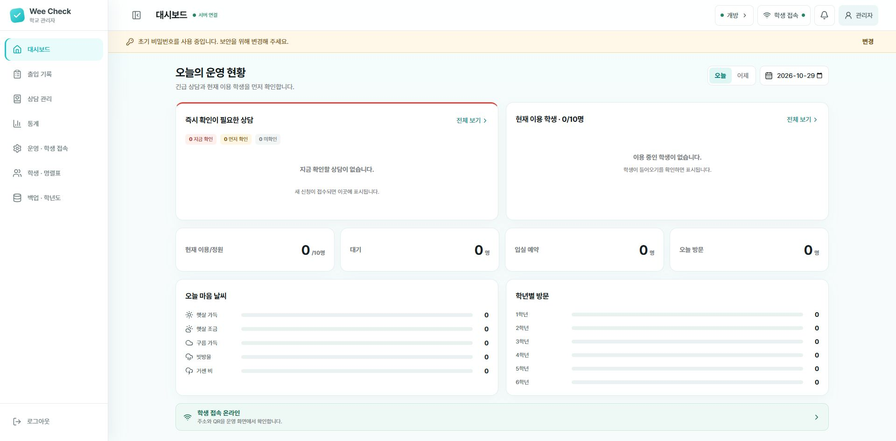

# Wee Check AP

> 학교가 관리하는 Wi-Fi 안에서 학생 출입, 마음 날씨, 상담 신청을 관리하는 Wee클래스용 프로그램

Wee Check AP는 학교 전문상담교사를 위한 Windows 프로그램입니다. 교사용 노트북에 설치하고 학생용 태블릿·휴대전화를 같은 학교 Wi-Fi에 연결하면 QR 코드로 이용할 수 있습니다.

학생 이름, 출입 기록, 마음 날씨와 상담 신청은 교사용 노트북에 암호화하여 저장합니다. 인터넷상의 별도 저장소에 학생 정보를 올리지 않습니다.

## 어떤 일을 할 수 있나요?

- 학생이 자신의 이름을 선택해 들어오기·나가기를 기록합니다.
- 입실할 때 마음 날씨를 선택하고 상담을 신청할 수 있습니다.
- 교사는 현재 이용 학생, 대기·예약, 상담 신청과 방문 통계를 확인합니다.
- 정원과 놀이시간, 요일별 개방 시간을 설정합니다.
- 학생 명렬표를 관리하고 기록을 암호화 백업합니다.

## 내려받고 시작하기

**[Windows 설치 파일 내려받기](AP%20ver/release/WeeCheck-AP-Setup-0.1.2.exe)** · 버전 0.1.2 · 약 33MB

파일 화면에서 **Download raw file**을 눌러 내려받으세요. 64비트 Windows 10/11과 학교가 관리하는 보안 Wi-Fi가 필요합니다. 처음 설치할 때 관리자 권한이 필요할 수 있습니다.

1. [설치 안내](docs/manual/installation.md)를 따라 프로그램을 설치합니다.
2. [처음 실행 안내](docs/manual/first-steps.md)에 따라 로그인하고 학교와 학생 정보를 준비합니다.
3. [매일 운영 안내](docs/manual/daily-use.md)를 보며 학생에게 QR 코드를 안내합니다.

## 그림으로 보는 사용 설명서

**[사용 설명서 전체 목차 열기 →](docs/manual/README.md)**

설치, 초기 설정, 일상 운영을 순서대로 읽거나 메뉴별 설명을 골라 볼 수 있습니다. 각 메뉴에는 실제 화면과 버튼 사용법을 담았습니다.

접속이 안 되거나 화면 사용이 어려우면 [문제 해결](docs/manual/troubleshooting.md)을 확인하세요. 데이터 보관과 삭제는 [별도 안내](docs/manual/data-and-removal.md)에서 설명합니다.

## 문의

Wee Check는 서울특별시교육청 전문상담교사이자 학교심리학자인 김한석이 제작했습니다.

- 제작자: 김한석
- 문의: [tedkim.psy@gmail.com](mailto:tedkim.psy@gmail.com)

## 저작권 및 이용 안내

Copyright © 2026 김한석. All rights reserved.

본 프로젝트의 소스 코드, 문서, 이미지 및 배포 파일은 무단 재배포할 수 없습니다. 사용 또는 배포 허가가 필요한 경우 위 이메일로 문의해 주세요.
