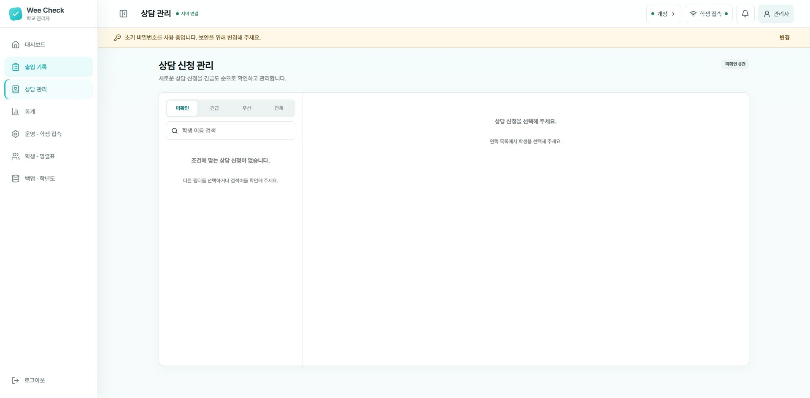

# 상담 관리

[설명서 목차](../README.md) · [프로그램 소개](../../../README.md)

왼쪽의 **미확인·긴급·우선·전체**로 신청을 골라 봅니다. 목록에서 학생을 선택하면 오른쪽에 신청 내용이 나타납니다. 사진은 아직 신청이 없는 상태입니다.

1. 관리자 화면에서 **상담 관리** 메뉴를 엽니다.
2. 긴급·우선·일반 순서로 신청 내용을 확인합니다.
3. 학생 이름, 고민 주제, 연락처와 안전 확인 답변을 살펴봅니다.
4. 학생을 직접 만나 학교의 상담 및 위기 대응 절차에 따라 확인합니다.
5. 확인한 신청은 처리 상태를 변경합니다.

> [!WARNING]
> 마음 날씨와 상담 질문은 심리검사나 진단 도구가 아닙니다. 화면의 분류만으로 학생의 안전을 판단하지 말고, 전문상담교사가 학생을 직접 만나 확인해야 합니다. 긴급한 안전 우려가 있으면 학교의 위기 대응 지침을 우선 적용하세요.
