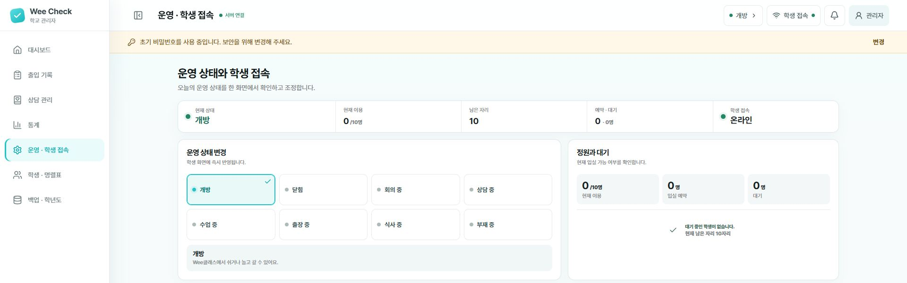
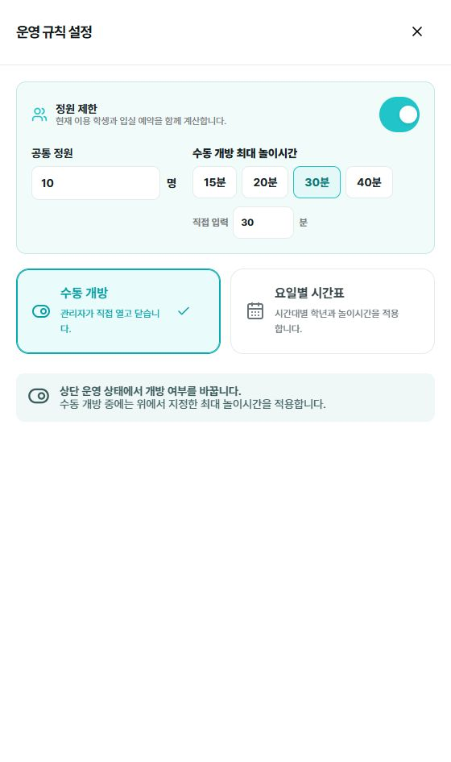

# 운영 · 학생 접속

[설명서 목차](../README.md) · [프로그램 소개](../../../README.md)

왼쪽 **운영 상태 변경**에서 **개방**을 선택합니다. 아래쪽 접속 영역의 **QR 보기**는 교사가 태블릿 PC에 학생용 화면을 열기 위한 기능입니다. 사진에는 접속 주소가 표시되는 아래 영역을 생략했습니다.

1. 교사용 노트북과 운영에 사용할 태블릿 PC를 같은 학교 Wi-Fi에 연결합니다.
2. 관리자 화면에서 **운영 · 학생 접속**을 엽니다.
3. 현재 운영 상태를 **개방**으로 바꿉니다.
4. 필요한 경우 이용 정원과 최대 놀이시간을 설정합니다.
5. 교사가 **QR 보기**를 누르고 태블릿 PC의 카메라로 QR 코드를 읽습니다. 또는 **주소 복사**로 확인한 주소를 태블릿 브라우저에 입력합니다.
6. 태블릿에서 학생용 첫 화면이 열리는지 확인하고 학생이 사용할 수 있도록 준비합니다.

QR 코드는 학생에게 배포하는 용도가 아닙니다. 학생은 교사가 접속해 둔 태블릿에서 자신의 정보를 선택해 이용합니다. 학생 개인 휴대전화 접속을 전제로 하지 않습니다.

노트북을 다른 Wi-Fi에 연결하거나 학교 Wi-Fi가 노트북의 주소를 바꾸면 기존 접속이 작동하지 않을 수 있습니다. 이때 교사가 관리자 화면의 현재 QR 코드나 주소로 태블릿을 다시 접속합니다.

> [!NOTE]
> 학생용 주소는 그날 운영하는 교사용 노트북에서 발급됩니다. 이전에 저장하거나 촬영한 QR 코드 대신 관리자 화면에 현재 표시된 QR 코드를 사용하세요.

## 정원·대기·놀이시간

**운영 · 학생 접속 → 설정 변경**을 누르면 오른쪽에 설정 패널이 열립니다. **공통 정원**에 인원을 입력하고, **수동 개방 최대 놀이시간**에서 시간을 선택합니다. 정해진 요일과 시간에만 열려면 **요일별 시간표**를 선택합니다.

- 기본 이용 정원은 10명입니다.
- 정원은 1명부터 99명까지 설정할 수 있습니다.
- 기본 최대 놀이시간은 30분이며 5분부터 180분까지 설정할 수 있습니다.
- 최대 시간이 지나도 학생을 자동으로 퇴실시키지 않으며 관리자 화면에 시간 초과로 표시합니다.
- 요일과 시간대별로 개방 시간, 대상 학년, 최대 이용시간을 다르게 정할 수 있습니다.
- 운영을 닫거나 정원 기능을 해제하면 남아 있는 대기와 예약이 정리됩니다.
