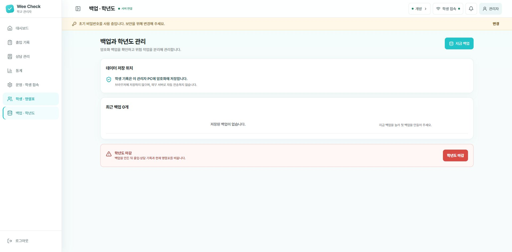

# 백업 · 학년도

[설명서 목차](../README.md) · [프로그램 소개](../../../README.md)

오른쪽 위 **지금 백업**을 누르면 아래 **최근 백업** 목록에 파일이 추가됩니다. 빨간색 **학년도 마감**은 현재 명렬표와 기록을 비우는 작업이므로 일상적인 백업에는 누르지 마세요.

관리자 화면에서 날짜별 출입 기록, 학생별 이용 이력, 마음 날씨 통계와 상담 신청을 확인할 수 있습니다.

중요한 명렬표 변경 전이나 학년도 마감 전에는 반드시 백업합니다.

1. 관리자 화면에서 **백업 · 학년도**를 엽니다.
2. **지금 백업**을 누릅니다.
3. 생성 일시가 표시되는지 확인합니다.
4. 복원이 필요하면 원하는 백업을 선택하고 안내 내용을 충분히 확인한 뒤 진행합니다.

백업 파일도 암호화되어 교사용 노트북에 저장됩니다. 최근 백업 30개가 유지됩니다.
